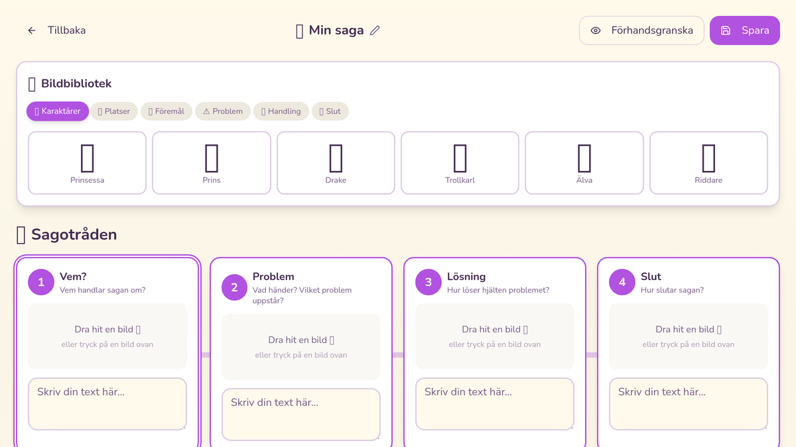

# Sagoappen

Sagoappen hjälper barn från förskolan till åk 3 att bygga en egen saga i fyra steg: vem,
problem, lösning och slut. Barnet väljer ett tema, lägger bilder på varje station, skriver
text och kan få tips av trollet Trollis.

**Spela:** https://sagoverkstan.skolappar.com · En del av [Skolappar](https://www.skolappar.com) – pedagogiska appar av föräldrar · öppen källkod (MIT)



Körs fristående.

## Vad du kan göra

- **Välj tema**: Klassisk saga, Djur & natur eller Äventyr. Varje tema har egna bilder för
  karaktärer, platser, föremål, problem, handlingar och slut.
- **Bygg sagan i fyra stationer** (Vem?, Problem, Lösning, Slut): dra en bild till en station,
  eller tryck på bilden och sedan på stationen (fungerar med fingret på iPad).
- **Skriv text** till varje station.
- **Trollis hjälper till**: *Tips*, *Fråga mig*, *Trollstaven* (ger ett textförslag) och
  *Förbättra*. Svaren skapas lokalt av regler och ordlistor, inte av en AI-tjänst.
- **Läs upp** en station eller hela sagan (se Integritet).
- **Exempelsagor** att läsa eller kopiera och bygga vidare på.
- **Mina sagor**: spara, öppna igen och ta bort.

## Kom igång

```bash
npm install
npm run dev        # utvecklingsserver
npm run build      # produktionsbygge till dist/
npm run build:dev  # bygge i utvecklingsläge
npm run preview    # förhandsgranska bygget
npm run lint       # eslint
```

Docker-bygget använder Node 22.

## Docker

```bash
docker build -t sagoappen .
docker run --rm -p 8080:8080 sagoappen
```

Bygget serveras av en liten Node-server, `deploy/server.mjs`, som också sköter uppläsningen.
Sätt `ELEVENLABS_API_KEY` för att slå på den: `docker run --rm -p 8080:8080 -e ELEVENLABS_API_KEY=… sagoappen`.

## Integritet

- Inget konto, ingen inloggning, inga kakor och ingen analys.
- Sagorna sparas bara i webbläsaren, i `localStorage` under nyckeln `sagoappen-stories`.
- Trollis svar och alla ljudeffekter skapas lokalt.
- Typsnittet Fredoka följer med appen (`public/fonts/`). Nunito ligger också med som reserv.
- **Uppläsning** är det enda som går över nätet. Texten skickas till appens egen server
  (`POST /api/story-narration`), som gör om den till tal hos ElevenLabs med rösten Charlotte.
  Nyckeln, `ELEVENLABS_API_KEY`, finns bara på servern. Utan den fungerar allt utom uppläsningen.
  Servern tar högst 5 000 tecken per uppläsning och 40 uppläsningar per adress och tio minuter
  (`NARRATION_MAX_CHARS`, `NARRATION_PER_10_MIN`).

## Struktur

```
index.html                    startskärm, metadata
src/
  pages/Index.tsx             växlar mellan start, temaval, byggare och förhandsvisning
  components/story/           startskärm, temaval, byggare, bildbibliotek, Trollis, förhandsvisning
  data/themes.ts              teman, bilder och de fyra stationerna
  data/demoStory.ts           exempelsagor
  lib/trollis.ts              Trollis svar, helt lokalt
  hooks/useStories.ts         sparade sagor (localStorage)
  hooks/useNarration.ts       uppläsning via appens server
  hooks/useSound.ts           små ljudeffekter med Web Audio
deploy/server.mjs             servern: appen och uppläsningen (ElevenLabs)
```

## Licens

MIT – se [LICENSE](LICENSE).
